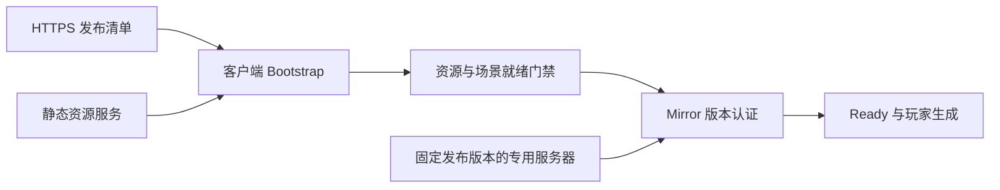

# My_3DProject 热更方案

文档性质：设计方案。本文约定资源更新、联机准入、场景加载、代码热更与双端发布的职责和机制。当前实现入口见 [项目权威文档索引](../../Y_MultipleAgentWorkflow/Router.md)，联机协议见 [同步协议](../../Y_MultipleAgentWorkflow/Multiplayer/Sync_Protocol.md)。

适用目标：Windows 客户端与 Windows Dedicated Server。内容产物按构建目标和进程角色独立生成。

## 1. 目标与技术路线

热更以一份完整的发布清单选择资源和代码，并在进入联机世界前完成下载、校验和装载。客户端与专用服务器围绕同一份玩法内容身份建立连接，整局固定使用同一份内容。

采用 Addressables 分发资源，采用 HTTPS 获取发布清单和内容文件，沿用 Mirror/KCP 承担实时联机。专用服务器保存随部署交付的确定版本内容，版本认证通过后放行 Ready 和 AddPlayer。代码热更通过 HybridCLR 承载独立业务逻辑，网络协议与基础运行层保留在 AOT。

接入顺序为：

1. 启动门禁、版本认证与表现资源更新。
2. 玩法场景资源化、客户端与服务器地图一致性。
3. HybridCLR 程序集拆分与代码装载。

资源更新可以按独立资源入口接入。场景是否整体资源化，由场景的内容职责和引用根决定。

## 2. 本项目接入依据

以下证据路径均相对项目根目录，描述工作区中的现有入口。

| 接入点 | 当前机制 | 证据 |
|---|---|---|
| 引擎与资源系统 | Unity 2022.3.62f3，Addressables 1.22.3 | `ProjectSettings/ProjectVersion.txt:1`、`Packages/manifest.json:4` |
| Addressables 内容入口 | `Scenes` 组为空，资源构建起点需要覆盖实际引用链 | `Assets/Plugins/AddressableAssetsData/AssetGroups/Scenes.asset:19` |
| Catalog 与路径 | Catalog 使用本地基线，组路径指向 Local Profile | `Assets/Plugins/AddressableAssetsData/AddressableAssetSettings.asset:20`、`:60`；`Assets/Plugins/AddressableAssetsData/AssetGroups/Schemas/Scenes_BundledAssetGroupSchema.asset:36` |
| Player 联动构建 | 配置取值委托给编辑器全局偏好，发布流水线需要显式选择构建策略 | `Assets/Plugins/AddressableAssetsData/AddressableAssetSettings.asset:44`；Addressables 包源码 `Editor/Settings/AddressableAssetSettings.cs:221` |
| 构建场景 | 启动层、常驻层、体素竞技场与两张多人测试图 | `ProjectSettings/EditorBuildSettings.asset:8` |
| 常驻层加载 | `InitialLoad` 注册常驻场景，通过 SceneManager 叠加加载 | `Assets/Core/Scripts/Scene/InitialLoad.cs:15`、`:40` |
| 内容场景加载 | `SceneChanger` 按实际 Scene 实例记录所有权，整组卸载再加载 | `Assets/Core/Scripts/Scene/SceneChanger.cs:45`、`:262`、`:307` |
| 当前首张玩法图 | `PersistentScene` 的初始场景组引用 `VoxelArena` 配置 | `Assets/Core/Scenes/PersistentScene.unity:1589`；`Assets/Core/SO/Scenes/VoxelArena.asset:17` |
| 客户端连接 | `AutoStartClient.Update` 按连接状态与重试时钟调用 StartClient | `Assets/Core/Scripts/Networking/Connection/AutoStartClient.cs:30`、`:69` |
| 服务端启动 | NetworkManager 在 Start 中执行 Headless 自动启动 | `Assets/Plugins/Mirror/Core/NetworkManager.cs:240`；`Assets/Core/Prefabs/NetworkManager.prefab:52` |
| 入场时序 | Mirror 默认 OnClientConnect 随认证结果执行 Ready 和 AddPlayer | `Assets/Plugins/Mirror/Core/NetworkManager.cs:1211`、`:1389` |
| 网络根与场景分工 | NetworkManager 持有玩家 Prefab，玩法图由项目场景管理器加载 | `Assets/Core/Prefabs/NetworkManager.prefab:63`；`Assets/Core/Scripts/Scene/SceneChanger.cs:307` |
| 角色资源入口 | 角色数组用下标表达 characterId，表现服务从已加载 Prefab 同步创建实例 | `Assets/Core/Scripts/Networking/CharacterPresentation/NetworkCharacterManager.cs:21`、`:117`；`Assets/Core/Scripts/Networking/CharacterPresentation/CharacterPresentationService.cs:28`、`:129` |
| 体素爆炸定位 | 爆炸消息携带平台 ID 与平台局部位置，平台注册随实际场景生命周期管理 | `Assets/Core/Scripts/Networking/Sync/NetworkBlastManager.cs:23`；`Assets/Core/Scripts/Scene/VoxelPlatform/VoxelPlatformRegister.cs:42`、`:63` |
| 程序集基础 | 状态机框架已有独立运行时程序集，可作为拆分依赖的参考 | `Assets/Core/Scripts/StateMachine/Core.FrameWork.StateMachine.asmdef:2` |
| 场景回归入口 | PlayMode 覆盖同名场景实例识别与反复切换的卸载归属 | `Assets/Tests/PlayMode/Scene/SceneChangerInstanceTests.cs:84`、`:99` |

Addressables 包源码和随包手册位于 `Library/PackageCache/com.unity.addressables@1.22.3/`。此处用它们核对本项目实际安装版本的 API 和构建语义。

## 3. 网络与内容服务的职责



| 组成 | 职责 |
|---|---|
| 发布清单服务 | 为客户端选择完整 release，提供兼容范围、Catalog 位置与文件校验信息 |
| 静态资源服务 | 提供 Catalog、Bundle 和热更程序集，可使用静态文件托管或 CDN |
| 客户端下载层 | 通过 UnityWebRequest 获取清单与代码文件，通过 Addressables 下载和装载资源，统一呈现错误与下载进度 |
| Mirror/KCP | 保持连接、身份、玩家生成、版本认证和实时同步 |
| 专用服务器部署 | 固定服务端二进制、玩法资源、协议身份和准入规则，提供与客户端相同语义的玩法世界 |

游戏服务器已有的 KCP 连接、超时与重连处理服务于实时会话。清单获取、HTTP 下载、文件校验与内容缓存由更新层管理，两者分别维护错误状态和重试预算。

## 4. 发布身份与联机准入

### 4.1 发布清单

| 标识 | 作用 |
|---|---|
| `appBuildId` | 标识二进制构建基线，匹配可用资源、AOT 元数据与最低客户端要求 |
| `releaseId` | 标识一次完整发布，绑定资源 Catalog、玩法内容、表现版本与热更代码 |
| `protocolId` | 标识 Mirror 版本、消息布局、网络 Prefab 拓扑、NetworkBehaviour 顺序与序列化契约 |
| `gameplayContentId` | 标识地图布局、碰撞、平台 ID、角色编号语义、移动与攻击配置及影响玩法的热更规则 |
| `presentationVersion` | 标识贴图、音频与纯表现资源的集合 |
| `hotfixVersion` | 标识热更程序集集合，并绑定其适用的 appBuildId |

清单同时记录目标平台、客户端或服务器角色、Catalog URI 与摘要、下载文件大小与 SHA-256、兼容的二进制基线，以及本次进入玩法需要预载的资源集合。清单中的比较规则使用明确的标识匹配和构建编号区间，版本字符串仅承担展示职责。

`gameplayContentId` 根据发布流水线整理的玩法输入清单生成，覆盖场景引用、平台映射、烘焙数据和规则配置。客户端与服务器通过同一份源数据描述生成相同的内容身份，各自的平台 Bundle 可以不同。

### 4.2 认证位置

在 AOT 中增加 `ContentVersionAuthenticator`，接入项目侧 NetworkManager 的 authenticator 槽位。版本请求和响应使用固定布局的 Mirror NetworkMessage，处理器允许认证前收发。其入口依据为 `Assets/Plugins/Mirror/Core/NetworkAuthenticator.cs:38`、`:57` 和 `Assets/Plugins/Mirror/Core/NetworkServer.cs:1090`。

认证顺序：

1. 客户端完成资源预载、角色模板准备和目标玩法场景激活，冻结本次会话使用的发布身份。
2. 建立 KCP 连接，客户端发送 appBuildId、releaseId、protocolId、gameplayContentId、presentationVersion 与 hotfixVersion。
3. 服务器检查二进制兼容范围，并精确比较 protocolId 和 gameplayContentId；表现版本按服务器配置的兼容集合检查。
4. 服务器返回接受或拒绝结果。接受结果驱动双方的认证成功回调，随后沿 Mirror 默认流程执行 Ready 与 AddPlayer。
5. 拒绝结果包含“需要更新”“二进制不兼容”“服务器维护”等固定原因。客户端关闭本轮连接，回到对应的更新或提示状态。

Host 的本地连接走同一套版本认证。错误版本在玩家对象创建前被拒绝，客户端展示本地缓存的版本号也需要经过服务器复核。

认证设置独立超时；超时、拒绝与断开统一清理待认证状态。处理器随网络端启动和停止注册、注销，重复启动 Host 或重连时保持一次有效处理。

### 4.3 重连与局内版本固定

`AutoStartClient` 在 `CanJoinSession` 成立时才允许发起连接。可重试的连接故障继续使用现有重连节奏；版本拒绝和强制整包更新会关闭该门禁，直到更新完成或用户明确重试。

同一局中的 Catalog、模板和热更程序集保持固定。发布服务切换 release 后，已开始的对局继续使用原版本，新连接按服务器准入集合选择版本。下载下一份内容与激活下一份内容分开管理，激活发生在退出会话后的启动流程。

## 5. 启动层与就绪门禁

### 5.1 客户端

增加包内 `Bootstrap.unity` 作为构建入口，承载版本清单、下载界面、失败提示和重试入口。`InitialScene` 与 `PersistentScene` 继续作为稳定的包内基础层。

```text
Bootstrap
  → 读取本地完整发布记录
  → 获取目标发布清单并检查 appBuildId
  → 初始化 Addressables 基础资源
  → 加载本次 release 的 Catalog
  → 计算依赖下载量并下载
  → 校验并装载热更代码
  → 加载角色模板与必要配置
  → 加载 InitialScene → PersistentScene → 目标玩法场景组
  → 确认碰撞、平台登记、角色模板与网络 Prefab 注册就绪
  → 打开 CanJoinSession
  → AutoStartClient → 版本认证 → Ready → AddPlayer
```

`Bootstrap` 持有跨场景可读取的启动状态，`InitialLoad` 管理常驻场景，`SceneChanger` 继续负责玩法场景组与加载事件。门禁采用明确的完成结果，覆盖加载成功、实际场景激活、平台注册成功和资源准备完成；只有整组成功才打开连接。

`SceneChanger.Start` 保留现有首组请求和事件订阅时序。地址解析与加载后端在其内部接入，场景组广播、过渡和完成回调继续沿用现有入口。首组内容来自选定 release，启动状态中的预期内容身份与实际加载结果一起核对。

### 5.2 专用服务器

服务器从部署目录读取固定发布清单和随部署交付的服务器资源。服务器使用相同的逻辑场景键和玩法内容身份，初始化平台、碰撞、角色合法编号及规则后才开始监听。

通过项目侧 NetworkManager 子类统一控制服务器启动，将 Headless 自动监听交给就绪门禁。`NetworkSpawnManager` 提供现有出生点扩展，网络管理扩展集中在同一项目侧管理器中。Prefab 与常驻场景实例的实际组件绑定随接入一起调整。

服务器资源由部署流程落盘；服务进程启动使用已选定的完整 release。服务端准备失败时进程报告失败，部署健康检查保持失败状态。客户端版本认证规则与服务进程实际载入的内容绑定。

## 6. 资源边界与引用管理

### 6.1 资源分层

| 资源层 | 承载内容 | 发布规则 |
|---|---|---|
| 包内基础层 | Bootstrap、InitialScene、PersistentScene、更新 UI、网络根、公共事件通道与基础配置 | 随二进制基线构建 |
| 表现资源层 | 角色模型、贴图、材质、动画片段、音频与粒子 | 通过远端 Catalog 发布，按已有组件契约装配 |
| 玩法内容层 | 玩法地图、碰撞、平台布局、烘焙网格、平台注册映射与规则配置 | 客户端与服务器共享 gameplayContentId，配套构建和部署 |
| 代码内容层 | 热更程序集及对应基线的 AOT 补充元数据 | 与 releaseId、appBuildId 和规则兼容身份绑定 |

表现资源的判定依据是运行时用途。带角色控制器、碰撞体、位移曲线或攻击配置的完整角色 Prefab，其更新需要逐项识别玩法影响；脚本类型使用包内已有契约，新增字段和类型进入代码与基线兼容流程。

### 6.2 角色装配

保留现有 `characterId` 同步和 `CharacterPresentationService` 的同步装配入口。在连接前把角色目录解析成现有使用方式所需的 GameObject 模板，并填充运行时角色表。所有可选角色的必要资源准备完成后才放行入场。

角色编号保持稳定，新增条目追加到目录；已有编号的语义与可选范围由 gameplayContentId 约束。服务端角色合法性校验读取同一目录中的编号与玩法描述，客户端预载完整表现模板，服务器准备自身需要的组件与碰撞资源。角色合法性与客户端视觉资源的加载状态分别判断。

角色模板的 AssetReference 替代常驻场景中的硬 Prefab 引用，单机开发角色也使用同一目录装配。`TryGetCharacterPrefab` 从预载后的模板表取值，使 Spawn 和 SyncVar hook 的装配保持同步。加载失败由启动层处理，入场后使用已验证的模板集合。

模板通过 `LoadAssetAsync<GameObject>` 加载，继续使用现有 Instantiate 与 Destroy 生命周期。模板 handle 的持有期覆盖全部关联实例；角色切换先销毁旧实例，在引用归零后释放模板。退出会话时先清理网络表现和单机实例，再释放目录资源。

`NetworkPlayer.prefab` 保留为稳定的包内网络根。Mirror 的 assetId、NetworkIdentity、NetworkBehaviour 顺序与序列化协议随二进制基线发布，网络根装配的视觉资源通过上述目录更新。

### 6.3 引用根与公共事件资产

内置场景对资源的硬引用形成包内副本，远端版本的生效依赖运行时实际使用已加载的远端对象。需要更新的入口改为地址或 AssetReference；构建分析检查共享依赖、包内副本和 Bundle 归属。

常驻管理器与远端场景之间共享的事件通道保留一个确定的运行时实例。平台登记、场景加载、音频与爆炸事件通过基础层注入或统一服务取得。将同一 SO 复制到不同 Bundle 后产生的独立实例，需要在引用设计与构建分析阶段消除。

## 7. 场景资源化

### 7.1 场景加载接口

场景目录以 `GameSceneSO.sceneName` 作为逻辑键，在选定 release 的 Catalog 中解析具体 IResourceLocation。包内场景通过 SceneManager 加载，远端玩法场景通过 Addressables.LoadSceneAsync 叠加加载。

`SceneChanger.LoadedScene` 保存 SO、实际 Scene 实例、加载来源和 Addressables handle。当前按实际实例识别所有权的机制继续保留，Addressables 分支直接使用 `handle.Result.Scene` 取得本次实例。

| 环节 | 约定 |
|---|---|
| 可加载性检查 | 包内分支检查构建场景；资源分支在选定 Catalog 中解析场景位置 |
| 成功判定 | 加载操作成功、Scene 有效且已激活、场景所需登记完成 |
| 完成事件 | 整组成功后更新当前场景，再广播现有 sceneLoadedEvent |
| 加载失败 | 关闭会话门禁，清理本轮已加载实例和 handle，返回加载失败界面 |
| 远端场景卸载 | 通过 Addressables.UnloadSceneAsync 释放对应实例与加载引用 |
| 包内场景卸载 | 使用原有 SceneManager 卸载链路，常驻场景按注册表保留 |

远端玩法场景进入独立资源目录后，其客户端构建场景入口随之移出 Build Settings。启动层与常驻层继续包内加载。服务端通过自己的部署目录解析相同逻辑场景键，构建清单由目标角色分别生成。

`GameSceneSO.SaveKey` 的定义继续归现有场景数据契约管理，资源下载和版本认证使用独立的发布身份。

### 7.2 体素地图一致性

平台 ID、平台根坐标关系、方块布局、烘焙网格、碰撞数据、地图触发器和规则配置作为同一玩法内容集合发布。服务器部署与客户端发布清单引用同一份 gameplayContentId。

平台注册继续通过 `VoxelPlatformRegister` 和现有注册事件完成，场景卸载按实际 Scene 清理登记。场景就绪信号在所有必要登记完成后发出。客户端发出的平台局部坐标只有在双方平台身份和布局一致时，才能复现同一次爆炸。

### 7.3 联机换图

场景加载技术与联机换图协商分别承担职责。联机模式下，服务器发布场景组、目标 gameplayContentId 与递增的场景轮次；客户端通过同一个 SceneChanger 加载并确认就绪。控制消息使用 AOT 中的稳定协议，携带本轮场景身份。

切换期间关闭战斗输入和本轮玩法消息入口，服务器收齐必要的客户端就绪结果后恢复对局。超时或失败的客户端退出本轮，过期轮次的确认与玩法消息被丢弃。单机模式下 SceneToggler 直接请求本地场景，联机模式下将意图提交给服务器协调。

涉及场景中 NetworkIdentity 的内容，额外验证双方 sceneId、激活顺序与 Mirror 场景对象注册。网络根继续常驻，地图切换的网络对象归属与生命周期纳入 protocolId。

## 8. Catalog、下载与缓存

### 8.1 Catalog 选择

基础资源组使用 Local Profile，表现资源与玩法内容组使用 Remote Profile。远端 Catalog 随二进制基线启用并归档，开发环境与发布环境通过 Profile 选择各自的构建目录和加载地址。配置入口为 `Assets/Plugins/AddressableAssetsData/AddressableAssetSettings.asset` 及 `AssetGroups/` 下的组与 Schema。

发布目录按二进制基线、构建平台、进程角色与 releaseId 隔离。构建产生的 Catalog、hash 和 Bundle 保持原有相互引用关系，上传后的内容使用固定 URI。清单保存构建实际生成的 Catalog 文件名。

启动层显式控制 Catalog 选择，关闭 Addressables 初始化时自动切换远端 Catalog 的行为。资源初始化后，按清单调用 LoadContentCatalogAsync 装入选定版本，保存返回的 IResourceLocator，再释放该加载操作的 handle。

会话资源在选定 locator 中解析为 IResourceLocation，再交给下载和装载 API。基础 Catalog 与内容 Catalog 即使存在相同逻辑键，业务资源也根据本次 locator 的解析结果加载，避免多个 Catalog 的全局键查找选中另一版本。

CheckForCatalogUpdates 与 UpdateCatalogs 适合固定更新入口；本方案以清单选定的完整发布快照控制装载。下载预热、场景解析、模板加载与代码文件选择使用同一份 release，保证版本选择一致。

### 8.2 下载状态

下载状态区分清单获取、Catalog 加载、资源下载、文件校验、模板装载与场景激活。资源下载界面通过 GetDownloadStatus 展示已下载字节与总字节，场景加载与激活单独显示准备状态。

HTTP 层设置超时、有限重试与取消入口。代码和自管文件先写临时文件，大小与 SHA-256 校验通过后改名提交；资源 Bundle 交给 Addressables 的缓存与校验机制管理。中断后复用校验通过的文件或缓存，具体文件续传能力由下载实现单独保证。

一个 release 的必要内容全部验证成功后，原子写入“最近一次完整发布”记录。启动失败保持上一份完整记录，部分下载的目录只作为下载缓存。缓存清理在退出会话后进行，保留当前发布与回退所需的完整集合。

### 8.3 离线与失败策略

包内基础层提供可启动的更新界面与本地开发入口。离线时，完整本地内容可以进入单机开发模式；联网准入仍由目标服务器验证。

首次安装缺少远端必要内容时停留在更新界面，提供重试和退出。强制整包更新进入明确提示状态。清单不可达时可选择最近一次完整发布，随后由服务器检查兼容范围；版本不符时关闭自动重连，保持可理解的失败原因。

## 9. HybridCLR 与程序集边界

### 9.1 职责划分

| 程序集边界 | 内容 |
|---|---|
| AOT 基础层 | 启动、下载、发布清单、场景加载适配、公共事件通道、角色资源接口与稳定入口 |
| AOT 网络层 | Mirror/KCP、NetworkBehaviour、版本认证消息、SyncVar、Command/RPC、自定义网络序列化和网络 Prefab 契约 |
| AOT 公共契约 | 热更入口接口、跨边界 DTO、资源服务接口和影响线格式的枚举 |
| 热更业务层 | 经接口调用的活动逻辑、UI 流程及规则策略，实现不修改 AOT 契约 |
| 编辑器构建层 | 编译、裁剪配置、桥接生成、程序集导出、内容身份计算和发布清单生成 |

依赖方向为“热更业务层 → 公共契约与基础服务”。AOT 通过稳定接口或反射入口启动热更代码。项目现有业务主要使用预定义程序集，拆分时将相关依赖一并归入明确的 asmdef，已定义程序集通过公共契约引用所需类型。

HybridCLR 支持热更 MonoBehaviour 和 ScriptableObject；本项目把网络组件与公共 SO 类型保留在 AOT，是维护序列化、事件实例与 Mirror Weaver 契约的工程选择。热更资源中的脚本类型必须在资源反序列化前完成程序集装载。

### 9.2 加载与验证

代码加载顺序为：选择 release → 校验程序集集合 → 加载该 appBuildId 对应的 AOT 补充元数据 → 按依赖顺序 Assembly.Load → 调用稳定入口 → 加载引用这些类型的资源 → 打开场景与网络门禁。

AOT 补充元数据来自匹配目标平台与二进制基线的裁剪产物，桥接和保留配置与同一基线归档。Editor 的 Mono 验证用于开发迭代，目标平台的 IL2CPP 构建负责验证泛型、反射、裁剪和真实装载行为。构建后端以对应目标的 Player Settings 为准，配置入口见 `ProjectSettings/ProjectSettings.asset:750`。

Mirror 的 Command/RPC、SyncVar、NetworkBehaviour 布局和网络序列化改动进入新的二进制协议基线。可热更的玩法策略仍通过 gameplayContentId 约束客户端与服务器兼容关系，服务器通过受控部署激活对应程序集。

程序集激活以进程启动为边界。回退热更代码时退出会话并重启进程，再装载旧 release 的程序集和资源。

## 10. 接入单元与验收

本节列出实施时的文件归属和交付边界。新增类型位于项目自有代码目录，职责按以下单元划分。

| 单元 | 文件或入口 | 职责与验收 |
|---|---|---|
| 发布描述 | `Assets/Core/Scripts/HotUpdate/ReleaseManifest.cs` | 描述发布、平台、角色、文件和兼容身份；拒绝字段缺失或目标不符的清单 |
| 下载服务 | `Assets/Core/Scripts/HotUpdate/ReleaseDownloader.cs` | 清单与代码文件下载、超时、有限重试、校验及取消；中断后保留完整缓存 |
| Catalog 会话 | `Assets/Core/Scripts/HotUpdate/ReleaseResourceSession.cs` | 固定 locator、按位置加载资源、统一持有 handle；同名键跨 Catalog 时仍加载指定版本 |
| 启动协调 | `Assets/Core/Scripts/HotUpdate/HotUpdateBootstrap.cs`、`Assets/Core/Scenes/Bootstrap.unity` | 汇总资源、模板、代码与场景结果；必要内容失败时门禁保持关闭 |
| 网络启动门禁 | `Assets/Core/Scripts/Networking/Connection/AutoStartClient.cs`、`NetworkSpawnManager.cs`、NetworkManager Prefab 与常驻场景实例 | 客户端入场与服务端监听均在就绪后发生；版本拒绝停止自动重试 |
| 版本认证 | `Assets/Core/Scripts/Networking/Connection/ContentVersionAuthenticator.cs` | 准入消息在 AOT 固定布局；错误版本在 Ready 与玩家创建前被拒绝 |
| 角色目录 | `Assets/Core/Scripts/HotUpdate/CharacterResourceCatalog.cs`、`Networking/CharacterPresentation/` | 预载模板并保持编号语义；单机、本地、远端与换角色共用资源目录 |
| 场景适配 | `Assets/Core/Scripts/Scene/SceneChanger.cs`、`InitialLoad.cs`、`SO/GameSceneSO.cs` | 分开处理包内和 Addressables 句柄；整组成功、失败清理和实例卸载可验证 |
| 地图发布与就绪 | `Assets/Core/Scripts/Scene/VoxelPlatform/VoxelPlatformRegister.cs`、场景组加载入口 | 地图、碰撞与平台注册纳入身份与就绪；旧场景登记随卸载清理 |
| 代码装载 | `Assets/Core/Scripts/HotUpdate/HotUpdateLoader.cs`、`Assets/Core/HotUpdate/` 下的独立程序集 | 依赖方向清晰；目标 IL2CPP 构建可以加载匹配元数据和代码 |
| 构建发布 | `Assets/Editor/HotUpdate/HotUpdateBuild.cs`、Addressables Profiles 与资源组 | 生成目标角色的构建清单、内容状态基线、玩法身份和发布清单 |

### 10.1 表现资源与准入

先以一项已有角色材质或音频作为远端内容入口，打通真实 Bundle 构建、清单选择、下载缓存、角色装配与认证。版本门禁和二进制基线随基础接入一起建立，随后用同一份客户端验证新的纯表现内容。

验收覆盖清空缓存首次下载、已有缓存启动、替换已有资源、新增符合已有脚本契约的资源、下载失败、连接失败与版本拒绝。专用服务器加两名客户端各自完成认证，每端的角色编号语义一致，相机与音频归属保持现有规则。

### 10.2 玩法场景资源化

将 VoxelArena 及实际被场景组引用的玩法图接入选定 Catalog，同时构建同一内容身份的服务器资源。玩法地图、碰撞和平台映射一起发布，联机换图使用服务器协调。

扩展现有 SceneChangerInstanceTests，覆盖 Addressables 加载分支、同名实例、加载失败与反复切换的句柄释放。集成验收检查双方平台 ID 和布局一致，同一爆炸能定位相同平台与方块；故意混用地图版本时认证拒绝。

### 10.3 代码热更

先以独立纯 C# 策略验证公共契约、依赖顺序与稳定入口，再接入实际业务。沿用同一二进制基线导出的 AOT 元数据，分别在 Editor 与目标平台 IL2CPP 上验收。

验收覆盖缺失程序集、摘要不符、错误元数据基线、入口异常、裁剪与泛型调用，以及代码回退后的重启装载。影响玩法的代码切换纳入双端发布与版本拒绝验证。

## 11. 构建、发布与回退

### 11.1 基线构建

1. 固定代码、Unity 与 Addressables 版本、目标平台、进程角色和资源组配置。
2. 分别构建客户端和服务器内容，检查重复依赖、公共事件资产身份、网络 Prefab 拓扑与玩法内容身份。
3. 归档各二进制基线对应的 addressables_content_state.bin、Catalog、Bundle、构建配置，以及对应的 AOT 和热更程序集产物。
4. 生成客户端与服务器发布清单，构建各自二进制，在发布环境执行联机验收。

Player 与 Addressables 的构建关系由流水线显式控制，配置入口为 AddressableAssetSettings.BuildAddressablesWithPlayerBuild。内容状态文件按二进制基线、目标平台与进程角色独立归档。

### 11.2 内容发布

1. 针对目标二进制基线执行 Check for Content Update Restrictions，再使用 Update a Previous Build 构建内容更新。
2. 将 Catalog 引用的完整依赖集合上传到固定发布目录；复用的旧 Bundle 保持可访问，新增 Bundle 与 Catalog 一起完成可达性和摘要检查。
3. 生成完整 release 清单，在候选服务器和客户端上验证准入、资源加载与玩法一致性。
4. 玩法内容变化时，服务器先停止接收新对局，完成现有对局后部署并通过健康检查，再切换客户端发布入口。具备独立匹配分流时按兼容版本分别准入。
5. 纯表现变化按服务器允许的版本集合放行；新二进制或协议变化进入整包与服务端配套发布。

发布入口最后切换，单个会话始终选择一份完整 release。新增资源按内容更新构建规则纳入 Catalog，验收同时覆盖已有资源替换和新条目加载。

### 11.3 回退

回退单位是发布清单绑定的完整资源、代码与玩法身份。资源服务保留旧 Catalog 和全部依赖，发布入口指向上一份可用 release；客户端退出会话并在重启流程中按旧清单重新选择 locator。

玩法回退同时恢复服务器部署和准入集合。代码回退通过重启进程生效，旧 AOT 元数据与二进制基线保持匹配。仅切换远端发布指针的客户端，也需要执行版本重选流程，正在运行的会话继续持有原有内容。

## 12. 机制参考

- 项目现行事实：[场景与流程](../../Y_MultipleAgentWorkflow/Scene/Scene_Guide.md)、[Mirror 与 KCP 工程配置](../../Y_MultipleAgentWorkflow/Project/Mirror_KCP_Config.md)、[专用服务器](../../Y_MultipleAgentWorkflow/Multiplayer/Dedicated_Server.md)、[同步协议](../../Y_MultipleAgentWorkflow/Multiplayer/Sync_Protocol.md)。工作区代码与资源是具体入口的取证依据。
- Addressables 1.22.3 随包手册：`Documentation~/content-update-builds-overview.md`、`content-update-build-create.md`、`LoadContentCatalogAsync.md`、`LoadingScenes.md`、`MemoryManagement.md`，位于本项目对应的 PackageCache 目录。
- HybridCLR 官方说明：[MonoBehaviour 支持](https://www.hybridclr.cn/docs/basic/monobehaviour)，用于核对脚本类型支持与资源装载顺序。
